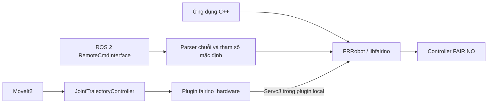

# Đối chiếu FAIRINO C++ SDK, frcobot_ros2 và MoveIt2 — manual 3.9.3

Ngày đối chiếu: 2026-10-02. Phạm vi: toàn bộ các nhóm API C++ trong §2.1.1–2.1.16, chương 8 `frcobot_ros2`, chương 9 `moveIt2`, và mã liên quan đang có trong workspace. Đây là rà soát tài liệu, chữ ký hàm, parser, cấu hình build và symbol thư viện; chưa kiểm chứng trên robot.

Nguồn chính là [PDF hãng trong workspace](../src/fairino-doc-en-readthedocs-io-en-3.9.3.pdf), trang in 1417–1671 cho C++, 2557–2574 cho ROS 2, 2575–2602 cho MoveIt2. Số trang này là số in trong sách, khác chỉ số trang của trình đọc PDF.

Nguồn đối chiếu trực tuyến: [C++ 3.9.3](https://fairino-doc-en.readthedocs.io/3.9.3/SDKManual/cpp_intro.html), [frcobot_ros2 3.9.3](https://fairino-doc-en.readthedocs.io/3.9.3/ROSGuide/ros2guide.html), [MoveIt2 3.9.3](https://fairino-doc-en.readthedocs.io/3.9.3/ROSGuide/moveIt2.html), [repository ROS 2 của hãng](https://github.com/FAIR-INNOVATION/frcobot_ros2), [repository C++ của hãng](https://github.com/FAIR-INNOVATION/fairino-cpp-sdk). Một số trang con C++ không tải được qua trình duyệt công cụ; phần tương ứng được đọc từ PDF local.

## Kết quả chính

**Có khác nhau về giao diện, phạm vi API và luồng điều khiển. Các lệnh ROS 2 cùng tên phần lớn gọi xuống SDK; chúng không phải một bộ thuật toán điều khiển robot độc lập.** Chương ROS 2 mô tả lớp tiện ích rút gọn, còn chương C++ mô tả giao diện SDK rộng hơn. Ngoài khác biệt thiết kế, tài liệu ROS 2 có ví dụ cũ hoặc mâu thuẫn với phần C++ và parser local.

Phải phân biệt ba đường gọi:

Service `MoveJ(...)` và trajectory do MoveIt2 gửi **không cùng đường thực thi**. Với service, controller robot nhận lệnh chuyển động cấp cao sau khi wrapper bổ sung tham số. Với plugin local, ROS 2 controller cung cấp các điểm khớp theo chu kỳ và plugin gửi `ServoJ`.

| Khía cạnh | C++ SDK | Service frcobot_ros2 | MoveIt2 / plugin local |
|---|---|---|---|
| Đầu vào | Hàm C++, struct, mảng, overload | Chuỗi `cmd_str` | Lệnh khớp qua ros2_control |
| Tham số | Truyền trực tiếp hoặc default của overload | Một phần trong chuỗi, phần khác từ ROS parameters hoặc hardcode | Cấu hình controller và plugin |
| Điểm đích | `JointPos`, `DescPose` | Tên `JNT1`, `CART1` trong bộ nhớ node | Trajectory khớp |
| Phản hồi | Mã lỗi và dữ liệu qua tham số output | `cmd_res` là chuỗi; topic trạng thái riêng | State interfaces của plugin |
| Đơn vị góc | Độ | Các lệnh khớp/pose rút gọn vẫn dùng độ | Plugin local đổi radian ↔ độ |
| Đơn vị vị trí/lực | mm, N, Nm theo loại dữ liệu | Giữ theo lệnh SDK; có chuyển đổi riêng ở AO | Cần xét interface cụ thể |
| Planning tránh vật cản | Không thấy hệ planning scene tương đương MoveIt2 trong các lệnh SDK được rà | Gọi service không tự bổ sung planning scene | MoveIt2 dùng mô hình và planning scene |

Kết luận về planning là suy luận từ kiến trúc/API đã đọc. Bảo vệ va chạm của controller, `FT_Guard`, và kiểm tra va chạm hình học của MoveIt2 là các cơ chế khác nhau.

## Phạm vi của toàn bộ phần C++ so với chương 8

Chương 8 liệt kê **58 tên lệnh**. Con số này là số lệnh trong chương tài liệu, không phải giới hạn khả năng của mọi bản repository ROS 2.

| Mục C++ | Nội dung đã rà | Mức thể hiện trong chương frcobot_ros2 |
|---|---|---|
| 1. Version Update | Thay đổi theo phiên bản, gồm ServoCart, IO reset, IK external axis | Không có changelog SDK tương đương |
| 2. Data Structures | JointPos, DescPose, ExaxisPos, ForceTorque, ROBOT_STATE_PKG | Chuỗi đầu vào và fairino_msgs; không phải ánh xạ nhị phân 1:1 |
| 3. Basics | RPC, đóng kết nối, version, log, reconnect, enable, mode | Liệt kê enable/mode/drag; node quản lý kết nối |
| 4. Robot Motion | JOG, J/L/C/Circle, servo vị trí/torque, spline, pause/resume, FIR, singularity, queue | Một phần lệnh chuyển động; không liệt kê ServoJ/ServoCart/ServoJT trong chương 8 |
| 5. IO | Đọc/ghi, đợi input, reset output khi dừng/tiếp tục | Liệt kê bốn lệnh ghi DO/AO |
| 6. Common Settings | Calibration tool/workpiece, payload, hệ tọa độ, friction, lỗi, sensor calibration | Một phần thiết lập hệ tọa độ, payload, friction, reset lỗi |
| 7. Security Settings | Collision, limits, custom threshold, power | Có các lệnh cơ bản; thiếu custom threshold và truy vấn soft limit trong danh sách chương 8 |
| 8. Status Query | Feedback, version trạng thái, FK/IK, điểm dạy, DH, hệ tọa độ | Hướng dẫn topic; `GET` ở chương 8 là điểm đã lưu, không phải truy vấn đầy đủ trạng thái robot |
| 9. Trajectory Recurrence | TPD, trajectory J/LA, force khi replay | Không liệt kê trong chương 8 |
| 10. WebAPP Program | Load/run/pause/stop program, quản lý Lua | Không liệt kê trong chương 8 |
| 11. Peripheral Devices | Gripper đầy đủ, conveyor, fieldbus, Lua thiết bị, laser | Liệt kê activate và move gripper |
| 12. Force Control | Sensor/config/zero, đo lực, guard, constant force, insertion/search, compliance, impedance, identification | Có tám lệnh FT cơ bản; không mô tả toàn bộ tìm kiếm/chèn/impedance |
| 13. Extended Axis | RS485, UDP, calibration, synchronized motion, external IO, tractor | Không có nhóm hướng dẫn riêng trong chương 8 |
| 14. Robot Welding | Arc, weave, tracking, wire search, recovery, process parameters | Không liệt kê nhóm này trong chương 8 |
| 15. Other Interfaces | Tải dữ liệu, sampling, point table, upgrade | Không liệt kê nhóm này trong chương 8 |
| 16. Appendix | Phân phối SDK Windows/Linux, build, lỗi thường gặp | ROS 2 hướng dẫn Ubuntu 22.04/Humble/colcon |

Mã service local có bảng đăng ký rộng hơn nhiều: các tên như `ServoJ`, `ServoCart`, `ServoJT`, `FT_SpiralSearch`, `FT_LinInsertion`, các lệnh conveyor/welding cũng xuất hiện. **Tên có trong bảng đăng ký không đủ chứng minh lệnh hoạt động:** ví dụ wrapper `Circle` local chỉ trả `-1`. CMake hiện cũng không tạo executable service này.

## Khác biệt đáng chú ý và lỗi/mâu thuẫn tài liệu

1. **Mã thành công:** §8.3.3 ghi `0` là lỗi, `1` là thành công. `robot_error.h` local định nghĩa `ERR_SUCCESS = 0`; `.srv` và phần lớn wrapper local trả chuỗi của mã SDK. Ví dụ `JNTPoint`/`CARTPoint` local cũng trả `"0"` khi thành công. Không áp dụng quy tắc `1 = success` của đoạn hướng dẫn này cho mã hiện có. `GET` và các getter cần parser riêng; không phải mọi `cmd_res` đều chỉ có một số.

2. **JOG:** C++ §2.1.4.1 dùng mã start `0/2/4/8`, còn §2.1.4.2 dùng mã stop `1/3/5/9`. Chương ROS 2 mô tả stop bằng `0/2/4/8`, và ví dụ `StartJOG(1,1,1,10)` không khớp mã start. Wrapper local không dịch các mã này: truyền trực tiếp xuống SDK. Nó còn đọc đủ **6 giá trị** `ref,nb,dir,vel,acc,max_dis`, trong khi chương ROS 2 chỉ mô tả 4. Các key `JOG_acc`/`JOG_maxdis` vẫn có trong YAML nhưng wrapper local này không lấy chúng để điền hai giá trị thiếu.

3. **MoveJ:** C++ có overload nhận joint+pose hoặc chỉ joint; wrapper dùng điểm lưu và gọi FK/IK để có joint+pose. Phần local đọc `point,speed,tool,user`, rồi có thể đọc thêm bốn external-axis positions; acceleration, scaling, blend và offset lấy từ parameters. Có tên giống nhau không có nghĩa là cùng chữ ký.

4. **MoveL/MoveC:** Chương ROS 2 ghi `MoveL(point,vel)` và `MoveC(point1,point2,vel)`. Parser local cần thêm `tool,user`. Phần C++ 3.9.3 còn mô tả lựa chọn blending, physical velocity/acceleration và overspeed tùy overload; wrapper local không cho truyền tất cả lựa chọn đó và gọi chữ ký cũ hơn còn được thư viện hỗ trợ. Không thể copy ví dụ rút gọn sang source local rồi mặc định coi là tương thích.

5. **Spline:** Chương ROS 2 ghi `SplinePTP(point,vel)` và `NewSplinePoint(point,vel,lastflag)`; parser local đọc lần lượt `point,speed,tool,user` và `point,speed,tool,user,lastflag`. `SplinePTP` local nhận `JNT`, `NewSplinePoint` local nhận `CART`. Ví dụ `NewSplinePoint(JNT2,20,0)` trong chương 8 trái với chính mô tả ở đó. `NewSplineStrart` là lỗi chính tả; tên đăng ký là `NewSplineStart`. C++ còn có `averageTime` và overload tự tính IK.

6. **Payload:** Chương ROS 2 đưa `SetLoadWeight(weight)`. Phần C++ §2.1.6.25 và parser local có thêm `loadNum`. C++ §2.1.6.26 mô tả `SetLoadCoord(loadNum,coord)` nhưng wrapper local đọc ba tọa độ và dùng overload cũ không có load ID. Symbol của `.so.2.3.3` local có cả hai overload `SetLoadCoord`.

7. **Tool/workpiece:** Chương ROS 2 ghi ID `1–15`; phần C++ cho các hệ tọa độ tương ứng ghi `0–14`. Đừng nhầm ID của điểm `JNT1` với ID hệ tọa độ. C++ còn có type/install/toolID/loadNum/refFrame tùy hàm. Wrapper local lấy một số từ parameters, một số hardcode về 0.

8. **External tool:** Chương ROS 2 mô tả ID + một pose sáu giá trị. C++ và parser local dùng **hai pose** `etcp` và `etool`, tức ID + 12 giá trị. Cả `SetExToolCoord` và `SetExToolList` có điểm này.

9. **Collision strategy:** Tài liệu tự mâu thuẫn. Prototype C++ §2.1.7.2 bỏ `safeVel`, nhưng ví dụ C++ ở mục kế tiếp và prototype ROS 2 có nó. Ví dụ ROS 2 `SetCollisionStrategy(1)` cũng không đủ theo parser local: wrapper đọc `strategy,safeDistance,safeVel`, đặt safeTime=1000 và sáu margin=1. Header và symbol `.so` local xác nhận chữ ký năm tham số của SDK, gồm safeVel.

10. **FT_Control:** Chương ROS 2 đưa ví dụ chuỗi **27 giá trị** theo giao diện cũ. C++ §2.1.12.21 mô tả overload thêm `M[2]`, `B[2]`, `threshold[2]`, `adjustCoeff[2]`, `polishRadio`. Header và thư viện local vẫn có ba overload. Nhưng wrapper service local chỉ có nhánh 36 giá trị và nhánh còn lại đọc theo dạng 32 giá trị; không có nhánh đúng cho ví dụ 27 giá trị. Đây là lệch parser/phiên bản, không phải ROS 2 không hỗ trợ force control. Nhánh còn lại không kiểm tra đủ số phần tử trước khi lấy `front()`; không coi việc thiếu tham số là chắc chắn sẽ được trả lỗi an toàn.

11. **FT_GetConfig:** SDK trả mã lỗi, điền bốn output qua pointer. Wrapper local trả chuỗi `rc,company,device,softversion,bus`. Vì vậy phát biểu trong chương 8 rằng chỉ `GET` trả dữ liệu chuỗi là không đầy đủ đối với source local.

12. **AO:** Wrapper local chuyển phần trăm sang `value/100*4095` trước khi gọi SDK. Trong khi đó, C++ §2.1.5.3–4 và header local đều mô tả đầu vào SDK là phần trăm 0–100. Ví dụ đầu vào service 50 sẽ được chuyển thành 2047.5, vượt miền được mô tả của SDK. Đây là điểm lệch có khả năng do chuyển đổi cũ còn sót; chưa xác nhận hành vi trên controller hoặc implementation nội bộ thư viện. Không coi việc scale sang 4095 là yêu cầu đúng của SDK 3.9.3 chỉ vì wrapper có đoạn code ấy.

13. **Gripper:** Service nhận index/position rồi bổ sung speed/force. Wrapper local hiện hardcode max_time=30000 và block=1 khi gọi SDK, dù đã đọc/appended các parameter tương ứng. Các tùy chọn gripper quay của SDK không được expose qua wrapper rút gọn này. Sự tồn tại của key YAML không đảm bảo nó được dùng trong lệnh thực tế.

14. **Chuỗi số:** Chương ROS 2 cấm ký tự ngoài chữ/số/phẩy/dấu trừ nhưng ví dụ lại chứa dấu chấm. Parser local bên ngoài dùng regex tham số `.*`; riêng JNT/CART có regex cho số thập phân. Đây là mô tả cũ/không đầy đủ; từng wrapper còn dùng `stoi/stod` riêng. Ví dụ speed của các wrapper MoveJ/L/C local dùng `stoi`, không bảo toàn phần thập phân như `float` được ghi trong hướng dẫn.

15. **Fake hardware:** Chương MoveIt2 §9.2.4 bảo đổi false→true để chạy robot thật. Trong cấu hình local đã đọc, `true` đi tới backend fake và `mock_components/GenericSystem`; backend fairino dùng plugin hãng. Hướng dẫn ấy không phù hợp với logic cấu hình local. Muốn xác định tác dụng phải xem nhánh plugin trong xacro/launch của đúng bản, không chỉ tên boolean.

Các mâu thuẫn ở trên có căn cứ riêng trong PDF §2.1.4, §2.1.6, §2.1.7, §2.1.12, §8.3–8.4 và §9.2.4. [Force control trực tuyến](https://fairino-doc-en.readthedocs.io/3.9.3/SDKManual/CPPRobotForceControl.html) xác nhận overload mở rộng; [Security settings](https://fairino-doc-en.readthedocs.io/3.9.3/SDKManual/CPPRobotSecuritySettings.html) cũng thể hiện mâu thuẫn prototype/ví dụ collision strategy.

## Đối chiếu đủ 58 tên lệnh trong chương 8

Bảng này mô tả quan hệ với SDK và điểm cần kiểm tra; không phải hướng dẫn chạy các lệnh trên robot.

| Lệnh chương 8 | Quan hệ / khác biệt |
|---|---|
| JNTPoint | Helper ROS lưu JointPos trong bộ nhớ node; không phải hàm SDK cùng tên |
| CARTPoint | Helper ROS lưu DescPose trong bộ nhớ node |
| GET | Đọc điểm đã lưu; không phải trạng thái hiện tại của robot |
| DragTeachSwitch | Cùng chức năng SDK; scalar được parse từ chuỗi |
| RobotEnable | Cùng chức năng SDK |
| Mode | Cùng chức năng; type trong mô tả C++/ROS có khác nhưng mode là scalar |
| SetSpeed | ROS ghi float; chữ ký SDK local dùng int |
| SetToolCoord | Struct pose bị trải phẳng; type/install và các ID khác bị ẩn hoặc hardcode |
| SetToolList | Tương tự SetToolCoord; có loadNum ở SDK |
| SetExToolCoord | ROS mô tả một pose; SDK/parser local cần hai pose |
| SetExToolList | Tương tự SetExToolCoord |
| SetWObjCoord | Struct pose; refFrame không có trong chuỗi rút gọn local |
| SetWObjList | Tương tự SetWObjCoord |
| SetLoadWeight | Chương 8 thiếu loadNum so với parser local |
| SetLoadCoord | Chương C++ có loadNum; local service chọn overload cũ |
| SetRobotInstallPos | Cùng chức năng SDK |
| SetRobotInstallAngle | Cùng chức năng SDK, parse hai số |
| SetAnticollision | SDK có mode + mảng level + config; wrapper lấy mode/config từ parameters |
| SetCollisionStrategy | Prototype/ví dụ tài liệu mâu thuẫn; local rút gọn ba scalar và hardcode phần còn lại |
| SetCollisionDetectionMethod | Cùng chức năng; thresholdMode có default trong C++ |
| SetStaticCollisionOnOff | Cùng chức năng SDK |
| SetPowerLimit | Cùng chức năng SDK |
| FT_SetConfig | Cùng chức năng SDK |
| FT_GetConfig | Pointer output trong C++; chuỗi rc + bốn giá trị trong service |
| FT_Activate | Cùng chức năng SDK |
| FT_SetZero | Cùng chức năng SDK |
| FT_Guard | Trải phẳng select, wrench và hai mảng threshold |
| FT_Control | Overload mở rộng và lệch 27/32/36 giá trị như phân tích phía trên |
| FT_ComplianceStart | Cùng chức năng SDK |
| FT_ComplianceStop | Cùng chức năng SDK |
| SetLimitPositive | Sáu scalar trong ROS thành một mảng SDK; ví dụ SetLimitPositve sai tên |
| SetLimitNegative | Sáu scalar trong ROS thành một mảng SDK |
| ResetAllError | Cùng chức năng SDK |
| FrictionCompensationOnOff | Cùng chức năng SDK |
| SetFrictionValue_level | Sáu scalar thành mảng SDK |
| SetFrictionValue_wall | Sáu scalar thành mảng SDK |
| SetFrictionValue_ceiling | Sáu scalar thành mảng SDK |
| ActGripper | Cùng chức năng SDK |
| MoveGripper | Ẩn tốc độ/lực/timeout/block và tùy chọn gripper quay; local có hardcode |
| SetDO | smooth/block được bổ sung từ ROS parameters |
| SetToolDO | Tương tự SetDO |
| SetAO | block từ parameter; local đổi phần trăm sang thang 4095 |
| SetToolAO | Tương tự SetAO |
| StartJOG | Chương 8 có bốn giá trị; SDK/parser local cần sáu; ví dụ sai ref |
| StopJOG | Chương 8 mô tả ref khác phần C++ |
| ImmStopJOG | Cùng chức năng SDK |
| MoveJ | Điểm lưu, FK/IK, tham số chuyển động mặc định |
| MoveL | Chương 8 thiếu tool/user theo parser local; không expose đủ tham số mới |
| MoveC | Hai điểm lưu cùng loại; local cần tool/user và chọn một số tham số chung |
| SplineStart | Cùng chức năng SDK |
| SplinePTP | Chương 8 thiếu tool/user theo parser local; chỉ nhận JNT trong wrapper |
| SplineEnd | Cùng chức năng SDK |
| NewSplineStart | Wrapper dùng default averageTime của SDK; ví dụ bị sai chính tả |
| NewSplinePoint | Chương 8 thiếu tool/user theo parser local, ví dụ sai loại điểm |
| NewSplineEnd | Cùng chức năng SDK |
| StopMotion | Cùng chức năng SDK; không đồng nghĩa việc một lệnh khác trả 0 là đã đến đích |
| PointsOffsetEnable | Sáu scalar được ghép thành DescPose; mô tả flag 0/2 nhưng ví dụ dùng 1 cần đối chiếu đúng SDK |
| PointsOffsetDisable | Cùng chức năng SDK |

Điểm lưu JNT/CART không đồng nghĩa điểm dạy trong database của controller. Source local dùng vector trong node; GET chỉ đọc lại vector đó. Các hàm SDK truy vấn teaching point hoặc quản lý point table là nhóm khác.

## Feedback, blocking và timing

`ROBOT_STATE_PKG` trong C++ chứa dữ liệu robot, mã lỗi, joint/TCP/flange, IO, lực và trạng thái khác. `RobotNonrtState.msg` là schema ROS riêng, do wrapper chọn và chuyển trường; không thể memcpy hai schema hoặc suy ra tất cả dữ liệu/chu kỳ đều giống nhau. SDK có getter như `GetRobotRealTimeState`, `FT_GetForceTorqueOrigin` và `FT_GetForceTorqueRCS`. [Data structures](https://fairino-doc-en.readthedocs.io/3.9.3/SDKManual/CPPDataStructure.html), [Status query](https://fairino-doc-en.readthedocs.io/3.9.3/SDKManual/CPPRobotStatusInquiry.html).

Wrapper service local đặt timer đọc trạng thái 10 ms. Điều đó không chứng minh mỗi callback nhận mẫu mới hoặc có bảo đảm thời gian thực. Plugin local đọc SDK state, xuất position/velocity/acceleration bằng radian và gửi ServoJ. Service và plugin có cơ chế feedback khác nhau; tên topic `nonrt_state_data` không phải cam kết deterministic timing.

Các tham số blend/block thay đổi ý nghĩa thời điểm hàm trả về. Chẳng hạn C++ mô tả blendT/blendR=-1 chờ đến đích; giá trị blending khác có thể không chờ. YAML local đang có MoveJ_blendT=500 và MoveL_blendR=500. Vì vậy **mã trả về 0 không tự chứng minh chuyển động đã hoàn tất**. Cần trạng thái motion-done/queue/feedback theo đường điều khiển đang dùng.

Không có căn cứ để kết luận SDK luôn nhanh hơn mọi luồng ROS 2 hoặc ROS 2 không điều khiển được lực. Service chuỗi có thêm parse/transport; plugin tránh đường service đó. Độ trễ và jitter thực tế cần đo trên cấu hình triển khai.

## Trạng thái riêng của workspace

Các nhận xét dưới đây là về checkout hiện có, không phải tuyên bố về bản release chính thức chưa tải được:

- Package có tên `fairino_hardware_v3_9_3`, CMake liên kết `libfairino.so.2.3.3`.
- `version_control.h` có package metadata 3.0.0, robot metadata **3.9.8**, message metadata 3.0.5. Đây là dấu hiệu metadata/source không đồng bộ tên thư mục; chưa đủ để kết luận firmware robot thực tế hoặc ABI của plugin đang chạy là 3.9.8.
- CMake hiện chỉ build/install thư viện plugin `fairino_hardware`; không có target executable `ros2_cmd_server`. Do đó 58 lệnh trong tài liệu không mặc nhiên được expose bởi build local.
- Plugin đăng ký là `fairino_hardware_v3_9_3/FairinoHardwareInterface`, khác tên không gắn phiên bản trong hướng dẫn hãng.
- Plugin local yêu cầu position command và position/velocity/acceleration state. Effort command đang bị comment; nhánh torque không gửi lệnh. SDK có ServoJT không có nghĩa plugin này đã triển khai effort control.
- Đã kiểm tra symbol `.so` bằng `nm -D -C`: có ba overload FT_Control, hai overload SetLoadCoord, SetCollisionStrategy có safeVel, và các MoveL overload cũ/mới. Kiểm tra này đọc binary, không mở kết nối robot.

Nguồn mã để kiểm tra lại: [CMakeLists.txt](../src/hardware_interface/fr10_driver/fairino_hardware_v3_9_3/CMakeLists.txt), [version_control.h](../src/hardware_interface/fr10_driver/fairino_hardware_v3_9_3/include/fairino_hardware/version_control.h), [robot.h](../src/hardware_interface/fr10_driver/fairino_hardware_v3_9_3/libfairino/include/robot.h), [robot_error.h](../src/hardware_interface/fr10_driver/fairino_hardware_v3_9_3/libfairino/include/robot_error.h), [command_server.cpp](../src/hardware_interface/fr10_driver/fairino_hardware_v3_9_3/src/command_server.cpp), [command_server.hpp](../src/hardware_interface/fr10_driver/fairino_hardware_v3_9_3/include/fairino_hardware/command_server.hpp), [parameters](../src/hardware_interface/fr10_driver/fairino_hardware_v3_9_3/fairino_remotecmdinterface_para.yaml), [plugin](../src/hardware_interface/fr10_driver/fairino_hardware_v3_9_3/src/fairino_hardware_interface.cpp), [service schema](../src/hardware_interface/fr10_driver/fairino_msgs/srv/RemoteCmdInterface.srv), [feedback schema](../src/hardware_interface/fr10_driver/fairino_msgs/msg/RobotNonrtState.msg), [xacro chọn backend](../src/vehicle_description/vehicle_description/urdf/fr10_ros2_control.xacro).

Đối với project FR10 này, MoveIt2/ros2_control phù hợp với planning và trajectory khớp; các chức năng controller riêng như cấu hình sensor, force control hoặc insertion có thể cần gọi SDK từ một node ROS 2 chuyên trách. Đây là đề xuất từ đối chiếu kiến trúc, chưa phải cấu hình force control đã được xác nhận tương thích với robot. Khi triển khai, phải chọn đúng header/library/plugin và firmware theo cảnh báo đồng bộ phiên bản ở §9.4.1 của hãng.
