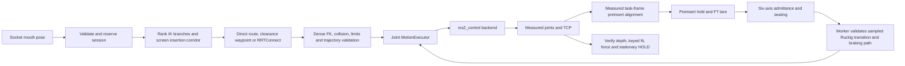

# FR10: một pose → preinsert → chèn theo lực → HOLD

Trạng thái triển khai và nghiệm thu được cập nhật tại
[PROGRESS_LEDGER.md](../PROGRESS_LEDGER.md). Các profile `matched_socket_v2`
hiện đang được commissioning trong mô phỏng. Chưa nghiệm thu chèn tiếp xúc trên
tất cả môi trường; không dùng kết quả kiểm tra CAD hoặc transport thay cho kết
quả chèn động lực học.

Mốc dụng cụ dùng chung cho mọi backend là
[`vehicle_description/config/fr10_tool.yaml`](../src/vehicle_description/config/fr10_tool.yaml).
Tool 0 (`plate_frame`) là tâm bề mặt mặt bích; Tool 1 (`charging_tcp`) là tâm
bề mặt trước của đầu cắm, không phải trọng tâm tải. Các biểu diễn mesh/collision
đều phải có cùng phép biến đổi Tool 0 → Tool 1. Offset wrench được launch suy
ra từ chuỗi cố định trong `robot_description`; không giữ cấu hình TCP riêng
trong IK hoặc bridge mô phỏng. Kiểm tra đồng bộ và Gazebo ngày 16/10/2026:
báo cáo (local: `test_results/fr10_tool_sync_20261016/REPORT.md`).

## Hợp đồng đầu vào

`/charging_port/raw_pose` nhận `geometry_msgs/PoseStamped`: tâm miệng cổng,
frame `fr10_base_link`, mét, quaternion chuẩn hóa, +Z hướng vào cổng, X/Y theo
khóa cơ khí. Với `force.automatic_pose: true`, một pose hợp lệ tạo đúng một
phiên chèn. Pose trùng/mới khi phiên đang bận không thay đổi mục tiêu đang chèn.
Trong phiên HOLD tại cổng, quyền điều khiển và parking lease được giữ.

Pose cũ/tương lai, NaN, quaternion không hợp lệ, dữ liệu robot không sẵn sàng
hoặc phiên đang bận bị từ chối. Hiện giao diện yêu cầu arm-base frame; chưa có
chuyển đổi tùy ý từ camera/world tại giao diện này. Thành phần perception phải
chuyển pose và timestamp về đúng hợp đồng trước khi gửi.

Khi tay máy gắn trên xe, `force.task_frame: world` giữ mục tiêu trong hệ cố định:
worker chuyển pose base ở đúng timestamp đo về task frame, sau đó giữ pose đó
bất biến. Hình học fixture nhận trong `world` được chuyển cùng một TF sensor
mới với mục tiêu khi chụp scene. Tại HOLD preinsert, một đường căn chỉnh thẳng
được kiểm tra lại trước FT_ZERO; không reset deadline phiên hoặc mốc parking.
TF mất/cũ hoặc fixture task frame thiếu phải từ chối kế hoạch. TF/MoveIt không
chạy trong tick 125 Hz. Đoạn chèn sau tare giữ corridor đã xác nhận; không dùng
cập nhật TF để che chuyển động đế xe. Với đế cố định, task_frame rỗng giữ hợp
đồng base cũ. Kiểm tra động lực học cho thay đổi này được ghi riêng trong ledger.

Action `/fr10_force/insert` và pose tự động dùng cùng admission/session. Kết quả
và feedback của cả hai được phát tại `/fr10_force/result` và
`/fr10_force/feedback`. `/fr10_motion/retract` là yêu cầu rút rõ ràng từ HOLD hoặc
FAILED đang giữ quyền. Không tự rút sau lỗi và không tự reset lỗi tủ.

## Luồng và quyền điều khiển



- `fr10_motion_core`: dữ liệu/IK hình học, quỹ đạo và executor; không ROS,
  MoveIt hoặc SDK.
- `fr10_motion_planning`: MoveIt collision/FK và OMPL; chỉ chạy trên worker.
  Nhánh đến preinsert phải hỗ trợ cả hành lang chèn. Đường vòng dùng điểm khớp
  trung gian, bo góc có kiểm tra va chạm và lấy mẫu đều theo chiều dài đường
  khớp. Time law FREE_SPACE kiểm tra jerk TCP trên FK của spline khớp; đoạn chèn/rút giữ trục đã chốt.
- `fr10_force_control`: conditioning, giới hạn lực và admittance implicit
  `M x'' + D x' + K x = F_desired − F_measured` có giới hạn/anti-windup.
- `fr10_insertion_manager`: admission, FSM, đo độ sâu từ khớp thực, commit
  correction sau khi lệnh đã được xác nhận, HOLD/recovery và parking.
- `fr10_pose_controller`: owner duy nhất của executor ở 125 Hz và adapter ROS.
  Tick không gọi MoveIt, SDK, network hoặc chờ worker.
- Plugin backend là owner duy nhất của actuator. Fairino giữ native ServoJ
  tám tham số, `cmdT=0.008`; không thêm SDK actuation trong controller pose.

Profile matched dùng approach compliant → contact alignment → insertion →
seating → verify → stationary HOLD. Sáu trục compliance chung một bộ luật;
không thay trục danh định mỗi khi gặp lỗi. Nominal lead tính cả correction đã
commit để không kẹt sau khi nhún theo lực. Khi unload, stiffness ngang/quay
đưa đầu cắm về pose có khóa; trục chèn vẫn điều khiển lực.

Ở tải cắm cuối, VERIFY và biên HOLD kiểm tra cả sai số lực ngang và mô-men
so với wrench mục tiêu danh định đã đổi về cùng frame đo. Tải dò tạm thời
không được dùng làm mục tiêu hoàn tất. Ngưỡng dùng chung
`force.alignment_force_tolerance_n` và `force.alignment_torque_tolerance_nm`;
giới hạn raw FT độc lập. Cấu hình MATCHED_MATING phải có norm deadband ngang/quay không vượt ngưỡng wrench hoàn thành, và deadband dọc không vượt ngưỡng hoàn thành/pre-stop. Kiểm tra này từ chối profile không tương thích trước admission; vẫn cần replay động lực học để xác nhận hội tụ. Progress ở seating dùng thành phần lớn nhất của sai
số wrench đã chuẩn hóa, nên căn chỉnh mô-men ở độ sâu đứng yên vẫn là tiến
triển, nhưng dao động hoặc chuyển state không gia hạn watchdog. AXIAL_CONTACT
giữ hợp đồng cũ. Stage38 đã chặn HOLD sớm ở ca X+2 mm/Ry−2° và dừng có kiểm
soát khi chưa căn giữa; ca này vẫn FAIL nghiệm thu hình học, không được coi
là đã xử lý xong sai số pose.

Gần vai chặn, vận tốc danh định giảm liên tục theo độ sâu đo thực. Vùng giảm
tốc lấy từ độ dẫn đã giới hạn và quãng đường phanh theo gia tốc; vận tốc cuối
không vượt tốc độ correction trục chèn đã cấu hình. Ngoài vùng này vẫn giữ
tốc độ yêu cầu. Luật dùng chung cho matched mating ở mọi backend, không thêm
state phục hồi riêng; giới hạn lực, xác minh và Ruckig/braking vẫn độc lập.

PlanningScene snapshot giữ ACM của scene. Provider chỉ cache riêng các cặp
link có biến đổi tương đối cố định qua toàn bộ cây khớp và khoảng cách hình
học tối thiểu 1 mm; không cache attached body, world hoặc cặp link có khớp di
động. Cặp cố định đang chạm nhau vẫn được kiểm tra theo ACM. Test đối chiếu
collision đầy đủ và cache bao gồm thay đổi ACM, vật cản world và khớp xe.

Worker kiểm tra cả đoạn Ruckig và đường giảm tốc từ q/v/a được chụp tại thời
điểm proposal. Profile matched hiện dùng deadline proposal64 ms, lease lệnh
đã chấp nhận96 ms cho kiểm tra đo được35 ms cộng bàn giao ở chu kỳ8 ms. Tick chủ động dừng nếu proposal đang chờ quá deadline;
wrench vẫn hết hạn độc lập sau 50 ms. SUCCESS hủy proposal đang chờ mà không
báo nhầm lỗi backend. Kiểm tra này chưa chứng minh toàn bộ thể tích correction
6D hoặc mọi đường từ một boundary khác khi worker trả kết quả muộn.

Khi fault: bỏ proposal chưa commit, giữ nguyên nguyên nhân, giảm tốc có giới
hạn jerk, rồi báo kết quả. Nếu đang trong cổng, giữ parking/quyền đến khi rút
được xác minh. Recovery vẫn cần wrench, robot và scene hợp lệ.

## Mô hình và dữ liệu

Nguồn cơ khí duy nhất là `vehicle_description/urdf/complete_visual.xacro` và
`models/matched_socket_v2/geometry.json`. TCP lấy từ fixed transform URDF;
không thêm offset tùy ý trong planner. Socket CAD gốc được giữ nguyên.
SRDF của cụm đầu cắm chỉ loại trừ ba cặp cố định trong cùng cụm; ACM trong
phiên force chỉ cho phép nose/shoulder với mating surface. Protected rear,
tay robot, chassis và fixture khác vẫn bị kiểm tra.

Gazebo matched dùng `fr10_simulation_hardware/GazeboTorqueSystem`, stable PD
với ma trận quán tính đủ sáu khớp và damping implicit từ vận tốc đo trực tiếp,
không đặt khớp tức thời sau khởi tạo.
QuickStep 2000 iterations, SOR 1.0 được kiểm tra bằng pose link độc lập để phát
hiện sai khác FK do nghiêng ngang bản lề. Bộ giải `world` đã bị loại vì lỗi
LCP tại vai chặn. Gain là dữ liệu hiệu chỉnh mô phỏng, không phải gain tủ Fairino.
Runtime không lưu mô-men tích phân; mô-men giữ tải lấy từ gravity các link vật lý.

Phản hồi vận tốc khớp Gazebo lấy từ chênh lệch encoder `Position()` và thời
gian physics giữa hai lần read, không từ thời gian nhận ROS. Dữ liệu trùng
không gia hạn timestamp hoặc giả vận tốc bằng zero; thời gian lùi/gap trên
20 ms hoặc encoder không hữu hạn làm backend báo lỗi. Damping của plant dùng
bộ đo encoder riêng theo bước physics 1 ms, cùng phép đo chuyển vị/thời gian.
ODE có thể báo vận tốc khái quát khác với biến thiên encoder sau khi giải
ràng buộc; dùng trực tiếp số đó gây boundary retarget giả đang chạy và độ lệch
tĩnh ở servo. Không lọc vận tốc hoặc đặt bằng zero khi có chuyển động thực.

Matched Gazebo đọc/phát trạng thái thật mỗi bước physics 1 ms; executor và
stream lệnh vẫn 125 Hz. Việc này giữ mẫu encoder mới khi CAD contact làm
physics chạy chậm hơn thời gian thực, trong khi timeout feedback/wrench vẫn
50 ms theo wall time. Không dùng timestamp mới cho mẫu khớp cũ. Native
Fairino giữ chu kỳ ServoJ 8 ms; thay đổi tần suất đọc này chỉ áp dụng Gazebo.

Trong matched Gazebo gắn xe, tám khớp bánh/lái dùng ODE joint motors với
effort limit URDF. Thân xe vẫn nổi trên contact bánh–sàn, không fixed hoặc
teleport. Parking đo đủ pose vật lý sáu chiều qua `/fr10_sim/base_odometry`
trong world; twist tính từ chênh lệch pose trong cửa sổ nguồn 16 ms
(`force.base_motion_pose_window_s`), nội suy tại đúng thời điểm đầu cửa sổ.
Đây là thay đổi băng thông phép đo: phản ứng với chuyển động liên tục có
độ trễ tối đa hai chu kỳ điều khiển; ngưỡng vận tốc 100 µm/s và 100 µrad/s
không đổi. Pose thô vẫn được kiểm tra độ trôi 200 µm/0.5 mrad từng mẫu;
timeout receipt 50 ms và dwell nguồn 200 ms không đổi. Không đủ lịch sử,
gap >20 ms, nguồn lùi hoặc pose không hữu hạn đều không được coi là đứng yên.
Một bước dịch 2 µm vẫn vượt ngưỡng ngay mẫu mới. Wheel odometry được lưu
riêng để đối chiếu. Chỉ publisher pose vật lý phát `world→base_footprint`;
swerve phải dùng đúng runtime YAML với `publish_tf: false`, kể cả spawner.
Cổng cố định trong world, pose đầu vào và scene snapshot được đổi về frame
tay đo thực. Di chuyển/drift thật vẫn dừng theo các ngưỡng parking không đổi.
Vì feedback plugin này chỉ có trong mô phỏng, commissioning xe thật cần
nguồn localization vật lý tương đương; wheel odometry riêng không chứng
minh chassis đứng yên.

Planner gom nguyên 4.368 tam giác từ 364 mảnh collision của nose thành một BVH
FCL. Manifest đối chiếu từng facet và hash nguồn, fail closed nếu CAD/transform
đổi; mô hình vật lý vẫn giữ các mảnh ban đầu. `model.urdf` và
`planning_model.urdf` được ghi riêng trong mỗi lượt thử.

MuJoCo sử dụng cùng URDF/socket pose và hai rigid flex từ nguyên tam giác
socket contact/rear, radius=0. Không thêm DOF, backing hoặc convex hull bao lỗ.
Test đối chiếu toàn bộ tam giác, bore mở và lực ở seat. Mô hình surface vẫn cần
giới hạn penetration độc lập; self-contact do PlanningScene kiểm tra. Các lượt
01–15 dùng surface shells 50 µm trước đây được giữ làm evidence, không phải
runtime hiện tại. Tham số `solref` là hệ số constraint MuJoCo, không được trình
bày như stiffness vật liệu đo thực tế.

Profile thử nghiệm mới dùng `matched_mujoco_contact` trong YAML calibration:
impedance tăng từ 0 đến 0,99 trên 50 µm penetration, giữ nguyên `solref`,
friction, tam giác và radius=0. Cách đặt `d0=0` theo
[hướng dẫn impedance của MuJoCo](https://mujoco.readthedocs.io/en/stable/modeling.html#impedance).
Đây là thay đổi luật tiếp xúc mô phỏng, không phải nới giới hạn nghiệm thu:
HOLD vẫn phải đạt lực 5±1 N, fit và penetration ≤50 µm. Cold replay chưa tái
tạo được burst ở run26 nên không được coi là bằng chứng đã chữa nguyên nhân.
Run29 đã PASS động học/contact/HOLD/rút cho front_mid/home với luật này;
các station/tư thế khác cần nghiệm thu riêng.

## Kiểm chứng và chạy lại

Build runtime sạch underlay:

```bash
./tools/build_simulation.sh
source tools/source_simulation.sh
```

Các vòng commissioning hiện tại dùng harness có trace độc lập và manifest
hash source/config/binary trước khi launch:

```bash
python3 tools/run_matched_station_gazebo.py test_results/<new-run> \
  --domain 191 --port 11985 --insert --six-axis --pose-input \
  --overlay src/fr10_arm_control/fr10_pose_controller/config/matched_socket_commissioning.yaml
```

Không ghi đè thư mục run. MuJoCo dùng cùng harness với `--backend mujoco`,
`--station-file <station.json>`. Không cần cache phân mảnh socket. Đây là lệnh commissioning, chưa phải profile
sản xuất đã được nghiệm thu.

Chọn `--station front_low|front_mid|front_high|left|right|tilted_up` và
`--initial-state home|left|right|folded` để chạy ma trận. Gazebo launch có tham
số tương ứng `station` và `initial_state`; đây là khởi tạo trước phiên, không
ghi đè joint feedback khi đang chạy. Harness có deadline thời gian thực riêng
cho thí nghiệm; timeout của goal và watchdog controller không đổi.

## Các chức năng làm mượt của hãng

Đã đối chiếu phần C++ trong manual 3.9.3 (local: `src/fairino-doc-en-readthedocs-io-en-3.9.3.pdf`)
(2.1.4.20, 2.1.4.51–54, 2.1.4.62–63) với SDK đi kèm driver.

| Chức năng | Phạm vi trong manual | Áp dụng ở pipeline này |
|---|---|---|
| `PtpFIRPlanningStart/End` | Giới hạn acceleration/jerk của PTP | Không tự áp dụng vào stream ServoJ |
| `LinArcFIRPlanningStart/End` | Làm mượt LIN/ARC theo acceleration/jerk | Đường chèn được ROS kiểm tra và time-parameterize |
| `SingularAvoidStart/End` | Bảo vệ kỳ dị trong bộ điều khiển hãng | Sàng lọc nhánh IK và tìm điểm trung gian trước khi gửi khớp |
| `ServoJ` | Vị trí độ và chu kỳ; acc/vel/filterT/gain chưa mở trong API này | Giữ tám tham số, 8 ms, các trường chưa mở bằng 0 |

Không chồng một bộ sửa đường của firmware lên quỹ đạo khớp đã kiểm tra trong
ROS. Muốn sử dụng FIR hoặc singular protection của firmware cần kiểm chứng
riêng rằng đường thực vẫn nằm trong corridor đã xác minh. Manual 3.9.3 có
điểm không nhất quán: mô tả ServoJ ghi cmdT 0,001–0,0016 s, còn ví dụ ngay
sau đó dùng 0,008 s và WaitMs(cmdT × 1000). Driver giữ 8 ms theo ví dụ và
quy tắc của repository; cần hãng xác nhận khoảng hỗ trợ khi commissioning tủ thật.

Chỉ PASS khi kết quả thành công, đo được HOLD, độ sâu/fit đúng, chỉ contact
được phép, penetration trong giới hạn, không LCP/crash và xác nhận controlled
stop trước khi tắt physics. Không chỉ dựa vào action result.

Docker hiện là image Fairino 3.9.3 tại `192.168.58.2`; transport SDK đã qua
preflight read-only. Container 3.7.8 được giữ để rollback. Cabinet phải do
người vận hành chọn Auto hoặc có ủy quyền rõ ràng riêng cho container đã xác
minh. Không auto-enable, auto-Mode hoặc auto-reset. Chèn lực qua SDK còn cần
gate mô phỏng riêng và nguồn contact wrench đã xác minh; mặc định backend
Fairino vẫn khóa force commissioning vật lý.

Observer Docker mới tính proxy contact quasi-static tại đúng khớp SDK đo,
không tích phân thêm servo MuJoCo và không phát JointState/clock/health hay
lệnh robot. Vận tốc0 chỉ nằm trong mô hình CAD tĩnh, không thay velocity SDK.
Stage vị trí/vận tốc được tính trước bù gravity; dùng
[`mj_forwardSkip`](https://mujoco.readthedocs.io/en/stable/APIreference/APIfunctions.html#mj-forwardskip)
để tính constraint một lần, không đổi model time. Unit test pose/force,
không tích phân và reject dữ liệu lỗi đã PASS. Benchmark200 trạng thái contact
20–40 µm: mean 6,551 ms, p95 6,757 ms, max 8,024 ms; tất cả dưới 50 ms,
không đổi measured q/model time, không gửi actuator. Đây là thời gian kernel
CAD riêng; E2E ROS/SDK actuation có evidence native83 riêng. Proxy này phục vụ SimMachine,
không phải FT trên robot thật.

Probe chỉ đọc có tùy chọn `--soak-seconds 10`: 1.250 lần đọc ở 125 Hz,
1.239 frame mới, 0 lỗi, frame age tối đa 8,003 ms trong lượt sau81. Mode Manual1
không đổi và số lệnh actuator bằng0. Báo cáo này không phải ServoJ soak.


Ma trận planner chỉ đọc đã qua 24/24 station/tư thế đầu, gồm kiểm tra sampled
FK, collision, corridor và braking; đây chưa phải nghiệm thu contact. Ma trận
động lực học chưa hoàn tất: nhiều station/tư thế đầu, pose sai lệch, đường vòng,
cancel/stop/retract, HOLD dài hạn, stale/overload/scene/clock faults, arm gắn xe,
native fault matrix và HOLD dài hạn. Native83 đã PASS một chu trình SDK tại
front_mid. Danh sách PASS/FAIL thực tế nằm trong ledger và từng
`summary.json`, không suy rộng PASS từ một station.

## Bằng chứng commissioning mới nhất

Bằng chứng lịch sử: Build81 và full CTest10 packages PASS (110 tests, một numerical IK test skip
theo cấu hình). Ma trận planner07 PASS24/24, không actuator. Mounted31 PASS
toàn chu trình ở tốc độ rút thường3 mm/s, HOLD5,005 giây nguồn đo: keyed error
122,78 µm, penetration9,74 µm, drift61,25 µm, sai số độ sâu sau rút7,99 µm;
parking release và node-first shutdown PASS, không unexpected contact/LCP.
Rút đo60,47 giây nguồn, so với140,55 ở mounted30 tốc độ0,5 mm/s.
MuJoCo31 nghiêng20°/folded PASS cắm/HOLD/rút: keyed66,23 µm,
penetration11,88 µm, sai số sau rút1,11 µm. MuJoCo overload31 còn PASS
HOLD5,001 giây nguồn và failure mới sau quá lực, `safety_fault=5`,
phanh có xác nhận. MuJoCo30 trước đó FAIL deadline validation; jitter chưa
được chứng minh loại bỏ hoàn toàn. Chi tiết, duration HOLD của từng run,
biểu đồ và giới hạn còn lại: báo cáo commissioning (local: `test_results/fr10_e2e_20261002/REPORT.md`).

Native85 mới nhất PASS từ tư thế người dùng đặt cách cổng1,174 m:
293 IK waypoints/1.884 timed samples đưa tới preinsert, sau đó cắm15,029 mm,
HOLD5,032 giây nguồn, keyed72,34 µm/penetration34,45 µm,0 SDK errors.
Theo yêu cầu, run85 không rút; đóng phiên có xác nhận và đọc lại đúng TCP cuối
`[-0.719928112,-0.158999665,0.304970281]`m. Cabinet Auto/enabled,10s read-only
soak PASS. Có một scheduler gap12,459ms; không suy rộng thành hard real-time.
Contact/native FT vẫn là CAD proxy. Full CTest lịch sử110=109PASS/1SKIP và27
Python checks PASS; evidence tại `test_results/fr10_e2e_20261002/validation84`.

Các lượt dưới đây là bằng chứng lịch sử của đúng revision đã lưu:

Gazebo arm-only/front_mid/home run 22 PASS một pose → preinsert → contact/HOLD
→ rút với servo implicit hiện tại: depth 15,039 mm, keyed error tối đa
71,46 µm, HOLD drift vật lý 1,23 µm, penetration tối đa 35,56 µm,
không contact ngoài dự kiến/LCP, rút về preinsert sai số độ sâu 4,47 µm.
Bằng chứng: `test_results/fr10_e2e_20261002/gazebo_contact_22/summary.json`.
MuJoCo run 22 đã PASS một pose → preinsert →
contact/HOLD → rút chủ động: depth 14,998 mm, keyed error tối đa 23,18 µm,
HOLD drift 0,88 µm, penetration tối đa 1,14 µm và không contact ngoài dự kiến.
MuJoCo run 24 cũng PASS cổng `tilted_up` (20°), tư thế đầu `folded` và rút:
keyed error 11,84 µm, penetration 0,88 µm, sai số độ sâu sau rút 1,04 µm.
Đây là các ca commissioning đã đo, chưa nghiệm thu mọi station/pose lệch.
Docker Auto đã PASS native83: cắm15,029 mm, HOLD5,008 giây nguồn đo,
rút về preinsert−30,0005 mm và nhả owner. SDK errors/tick misses/gaps bằng0;
loop124,992Hz. Contact/load chỉ là proxy CAD quasi-static tại đúng SDK q.
Lượt84 sau đó gặp ServoJ14 và backend COMM_FAILURE, chưa rút hoàn tất, giữ FAIL.
Không coi ma trận reachability, SDK transport hoặc proxy Docker là tiếp xúc thật.

Compile probe chỉ đọc với SDK đang dùng trong driver, từ thư mục workspace:

```bash
g++ -std=c++17 tools/fr10_simmachine_readonly_probe.cpp \
  -I src/hardware_interface/fr10_driver/fairino_hardware_v3_9_3/libfairino/include \
  src/hardware_interface/fr10_driver/fairino_hardware_v3_9_3/libfairino/lib/libfairino.so.2.3.3 \
  -Wl,-rpath,"$PWD/src/hardware_interface/fr10_driver/fairino_hardware_v3_9_3/libfairino/lib" \
  -pthread -o /tmp/fr10_simmachine_readonly_probe
python3 tools/fr10_simmachine_preflight.py \
  --probe /tmp/fr10_simmachine_readonly_probe \
  --output test_results/native_readonly.json
```

Probe lấy IP từ `docker inspect fairino-container` trước khi đọc SDK. Báo cáo
transport không cấp quyền đổi Mode/enable/reset hoặc chứng nhận chuyển động.

Harness `--retract-after-hold` chỉ gửi yêu cầu rút sau insertion success và
HOLD đã được ghi nhận. Nó kiểm tra TCP vật lý tại preinsert, load đã nhả và
owner force đã trả; evidence giữ cửa sổ seated trước khi rút riêng biệt.
RETRACT vẫn kiểm tra raw overload, stale wrench và các giới hạn bảo vệ.
Khi TCP còn ở trong cổng, RETRACT cũng yêu cầu clearance keyed; không chỉ
kiểm tra điểm cuối. Profile arm-only rút giới hạn 3 mm/s; giới hạn thử nghiệm
trên xe lấy từ YAML geometry: run30 PASS ở0,5 mm/s, run31 PASS ở3 mm/s
sau vùng nhả tải, cùng jerk thấp. Quan sát HOLD kéo dài 5 s,
ghi drift TCP vật lý độc lập với FK từ joint feedback.

Nhả tải dùng một time law trong chính quỹ đạo rút thẳng: tốc độ đầu được giới
hạn qua `force.retract_initial_distance_m`, rồi trần tốc độ blend quintic về
giới hạn rút thường trên cùng quãng đường. Ruckig giữ vận tốc/gia tốc đầu,
horizon dự đoán gồm quãng phanh, và endpoint vẫn là preinsert gốc. Toàn bộ
sample chịu kiểm tra jerk, FK/FCL, corridor và braking; không thêm state hay
điểm dừng trung gian. Profile matched dùng100 µm đầu ở25 µm/s; trên xe dùng
2,5 µm/s từ YAML geometry. Unit test và full cycle mounted30 đã PASS.
Run30 đo tốc độ chassis cửa sổ16 ms tối đa23,67 µm/s và81,56 µrad/s,
trong giới hạn100 µm/s và100 µrad/s. Run31 ở tốc độ thường3 mm/s cũng PASS;
replay16 ms có maxtranslation23,23 µm/s, maxangular81,55 µrad/s trên các
cửa sổ journal hợp lệ. Report ghi riêng32 cửa sổ không đủ history; không
điền zero hoặc dùng chúng để chứng minh guard. Live parking guard PASS riêng.

Harness hiện yêu cầu đủ5 giây timestamp joint feedback đo và ít nhất5 giây
wall-clock trước khi rút hoặc inject fault. Clock đứng yên không hoàn thành
quan sát; clock lùi/nonfinite bị từ chối. Report ghi cả hai duration.
Các run đến MuJoCo31/mounted30 dùng gate5 giây wall-clock trước đây;
không coi chúng là5 giây physics khi RTF thấp.

`force.minimum_progress_m` là độ phân giải bước tiến một chiều của watchdog,
mặc định 100 µm. Profile matched dùng 10 µm vì giới hạn seating 25 µm/s
chỉ cho phép 50 µm trong timeout 2 s. Timeout, ngưỡng cải thiện tải, deadline và
tiêu chí HOLD giữ nguyên; dao động qua lại không làm mới mốc độ sâu cực đại.
MuJoCo28 đã qua lần chạm đầu trong ca front_mid/home nhưng dừng
NO_PROGRESS trước tải seat. MuJoCo29 với độ phân giải watchdog được hiệu chỉnh
đã PASS HOLD và rút; keyed error59,51 µm, penetration11,79 µm, HOLD drift0,143 µm,
sai số độ sâu sau rút1,123 µm. Xem `mujoco_29/summary.json` trong bundle
`test_results/fr10_e2e_20261002` và snapshot/hash kèm theo từng run.

Servo Gazebo cập nhật mỗi bước vật lý cấu hình. Damping được giải implicit theo
ma trận quán tính 6 × 6 từ mass/CoG/inertia/axis/anchor vật lý, có cả coupling
giữa các khớp, cùng feedforward trọng lực. Cách tính dựa trên phương trình
10–11 của [Tan, Liu và Turk (2011)](https://faculty.cc.gatech.edu/~turk/my_papers/stable_pd.pdf);
contact và chuyển động base vẫn cần nghiệm thu vật lý riêng. Không dùng tích phân vị trí để giữ
trọng lực hoặc tích mô-men chống vai tựa trong lúc seating. Wrist stiffness
và damping nằm trong `fr10_simulation_actuators.yaml`; tất cả mô-men vẫn
bị chặn theo giới hạn URDF. Các gain này cần nghiệm thu contact/retract mới.

FT Gazebo phát mỗi physics step (`update_rate=0`). Consumer force 125 Hz giữ
extrema của từng thành phần raw và mọi packet không hợp lệ giữa các tick;
xung lực ngắn không bị packet bình thường kế tiếp che mất. Filter và thống kê
tare xử lý mọi mẫu nguồn duy nhất trong batch cố định tối đa1024 mẫu trước khi
lấy đầu ra ở125 Hz. Batch bao phủ1000 mẫu tại bước tối thiểu50 µs và watchdog50 ms. Mỗi batch
dùng biến đổi frame từ cùng quan sát TCP của tick; trong chuyển động chèn
chậm, sai lệch frame bị giới hạn bởi chu kỳ đọc. Không thêm FK/MoveIt/network
hoặc tích phân admittance mỗi mẫu. Overflow làm bằng chứng không hợp lệ;
tare vẫn cần25 quan sát control riêng, không rút thành25 mẫu vật lý.
Timestamp nguồn/receipt của mẫu cuối vẫn độc lập; timestamp trùng không gia hạn watchdog 50 ms. Harness
kiểm tra cả tải biết trước và độ ổn định wrench lúc nghỉ trước khi gửi pose.

Commissioning giới hạn FREE_SPACE TCP ở 0,10 m/s (scale 0,125) và khớp ở
scale 0,25; acceleration/jerk theo cùng bộ ba S-curve. Giới hạn bám khớp
1° vẫn giữ nguyên. Live seed có vận tốc lệch hướng đường quá 10% sẽ dừng
có kiểm soát rồi lập lại đường, kể cả vận tốc rất nhỏ; không biến nhiễu
khởi đầu thành đoạn spline cong lớn/chạy chậm bất thường. Lỗi bám, scene,
giao tiếp hoặc quỹ đạo đã hết hiệu lực được truyền lên force session,
kết thúc bằng lỗi có xác nhận dừng thay vì chờ hết goal timeout.

Lease của target online đã chấp nhận tính từ source time hiện tại tại admission
(`max(ROS clock, measured feedback stamp)`), kể cả khi executor cập nhật feedback
sau admission trong tick. Mốc này phải còn nằm trong deadline proposal gốc;
mốc quá khứ, tương lai ngoài deadline hoặc NaN bị từ chối. Lease 64 ms, deadline
proposal 48 ms và wrench freshness 50 ms giữ nguyên. Không reset tuổi wrench
hoặc gia hạn một proposal đã hết hạn.

Khoảng giảm tốc C1 trước vai cổng tính cả lead lệnh và dung sai độ sâu đã cấu
hình, cộng quãng phanh theo giới hạn gia tốc. Nhờ đó shoulder đến sớm trong
khoảng dung sai không còn bị xử lý ở tốc độ gần nominal. Floor vẫn là giới hạn
vận tốc hiệu chỉnh hiện có; force/admittance và watchdog dùng dt thật, chỉ tiến
trình nominal được giảm tốc. Không thay dung sai nghiệm thu hoặc ngưỡng parking.
Parking feedback/heartbeat có SingleThreadedExecutor riêng, được thử khi cả ba
worker ROS thông thường bị callback 80 ms chiếm dụng; nguồn dừng vẫn bị loại
sau 50 ms, dữ liệu trùng không làm mới freshness.

Lượt xác nhận seating dùng xu hướng lực qua cửa sổ nguồn bằng dwell xác nhận
(`force.completion_hold_s`, profile200 ms), với ngưỡng5 N/s hiện có. Đây là
thay đổi băng thông phép đo nghiệm thu; ForceSafety vẫn kiểm tra rate tức thời,
đỉnh lực thô, overload, dữ liệu không hợp lệ và freshness độc lập. Thiếu lịch sử,
nguồn lùi hoặc gap vượt timeout cảm biến đều không đủ điều kiện xác nhận.
Deadband dọc trục0.5 N chừa một nửa dung sai1 N cho ripple đo; dung sai lực,
độ sâu, keyed clearance và dwell không thay đổi. Matched MuJoCo đọc/phát mẫu
thật mỗi physics step1 ms, executor vẫn125 Hz; không chỉ lấy wrench của substep
cuối mỗi8 ms. Các sửa đổi này đang được nghiệm thu vật lý lại.

## Pose có sai số và tham chiếu contact nội bộ (2026-10-03)

`pose_uncertainty_commissioning.yaml` kế thừa profile matched qua loader dùng
chung trong launch/harness. Đây là profile đang nghiệm thu; kết quả từng ca ở
`test_results/fr10_admittance_pose_error_20261003/WORK_LOG.md`, không suy rộng
PASS sang toàn ma trận hoặc robot thật.

X/Y giữ stiffness dương. Deadband tác động lên drive, không thay force dùng
cho safety hoặc xác nhận. Rx/Ry dùng SO(3): spring error là
`log(Exp(correction) Exp(equilibrium)^-1)` và pose dùng quaternion composition.
Các phép quaternion dùng chung math_utils của ROS-free motion core.
Tham khảo nguyên lý stiffness/reference của
[admittance_controller Humble](https://control.ros.org/humble/doc/ros2_controllers/admittance_controller/doc/userdoc.html)
và [FZI ros2 compliance](https://github.com/fzi-forschungszentrum-informatik/cartesian_controllers/blob/ros2/cartesian_compliance_controller/README.md);
không build master và không đưa controller của các repo này vào claim joint.

ContactReference quan sát tiến độ thật và tìm spiral có giới hạn khi bị chặn.
`CAPTURED` chỉ nhận equilibrium tịnh tiến sau khi vượt lead-in tới8 mm với
250 ms tải lateral/moment nhỏ. Lọt vào bore có clearance không chứng minh được
trục cổng; hướng quay chưa được khóa tại đây. Điểm cửa vào suy ra từ tip/depth/
hướng đo lúc capture được giữ cố định. Equilibrium XY được vận chuyển theo
độ sâu và hướng correction đã được executor chấp nhận; không bám displacement
đo liên tục và không coi hướng đó là trục đã xác nhận. Spring quay vẫn tham
chiếu zero. Lực dò2 N vượt ngưỡng nhận tiếp xúc1 N cộng deadband dọc trục0,5 N; giữ tới khi loaded-axis anchor được commit, sau đó mới
chuyển sang lực seating5 N. `ACQUIRED` nhận anchor cuối ở
seating, khi có tải dọc trục và moment<=0,01 Nm ổn định. Anchor cuối được giữ
cố định, không liên tục bám bias FT. Đường tiến và wrench mong muốn sau đó theo
trục đã nhận; pose/frame đầu vào vẫn bất biến.

Spiral radius2,5 mm/pitch0,25 mm, speed0,5 mm/s tính theo arclength; tìm kiếm và
căn dưới tải cùng bị giới hạn bởi source budget180 s, không được gia hạn do
worker pending. Goal deadline600 s vẫn độc lập. Stiffness XY200 N/m và rotational
0,02 Nm/rad đều dương; damping xoay20 cùng probe có giới hạn đã PASS các ca MuJoCo ghi trong ledger.
Đây là gain commissioning mô phỏng. Reference và correction vẫn chịu các
giới hạn force/torque, tracking, TTL, collision và singularity hiện có.

Admission dùng `ForceCorridorContract`: legacy `FIXED_NOMINAL` kiểm tra full
ray như trước; `CONTACT_ADAPTIVE` kiểm tra full ray về IK/branch/braking và
kiểm tra collision/braking tới vùng vào tiếp xúc. Pose sai không phải là đường
lắp cuối cùng. Mọi target đã hiệu chỉnh sau đó vẫn phải qua exact transition
và controlled-stop collision validation trên scene cố định trước khi phát lệnh.

Reference/spiral/nominal/admittance cùng propose/commit với target đã qua IK,
worker collision/braking và MotionExecutor admission. Reject/discard không
làm tiến path hoặc nhận anchor; deadline nguồn và safety vẫn chạy mỗi tick.
Không có lệnh firmware FT_Control/FT_LinInsertion và không có publisher joint
thứ hai trong force/session libraries. HOLD chỉ giữ vị trí và giám sát lực.
Khi hết ngân sách hoặc có fault: controlled stop có xác nhận, không tự reset,
rút hay khởi động vòng tìm kiếm mới.

Tare là bias residual tại pose **không tiếp xúc**, khi tool/payload vẫn gắn.
WrenchTare kiểm tra sample duration/gap/variance; adapter kiểm tra clearance,
measured joint velocity, scene, source health và base đứng yên trên mỗi tick,
kể cả khi FT chưa có mẫu mới. Không dùng commanded IK seed
để suy ra robot đứng yên. Owner bù gravity được khai báo, ứng dụng không bù
lần nữa nếu nguồn đã bù. Driver Fairino raw/reference/active, giới hạn timestamp
và API thực tế: [force sensor handoff](fr10_force_sensor_handoff.md).

Anchor là ước lượng từ FT/q, không được coi là tọa độ tâm thật. Trong simulator,
CAD/pose vật lý của cổng giữ nguyên; injector chỉ đổi message raw_pose. Nghiệm
thu fit/penetration dùng independent physics TCP và CAD gốc. Khi chỉ có FT/q ở
robot thật, kết quả là mechanically seated estimate; chưa có xác nhận điện/latch.
Rút theo trục ngồi thực đã đo đến clearance, không kéo ngang về pose đầu vào sai
trong khi pin còn cắm. Endpoint preinsert đầu vào vẫn được giữ để audit.

Lệnh commissioning MuJoCo, sai số input radius2 mm và rotation-vector norm2°:

```bash
source tools/source_simulation.sh
ROS_DOMAIN_ID=224 ROS_LOCALHOST_ONLY=1 python3 tools/run_matched_station_gazebo.py \
  test_results/<new-run> --domain 224 --port 11994 --backend mujoco \
  --insert --six-axis --pose-input --retract-after-hold \
  --overlay src/fr10_arm_control/fr10_pose_controller/config/pose_uncertainty_commissioning.yaml \
  --pose-lateral-mm 2 0 --pose-rotation-deg 0 0 0 --run-timeout 1500
```

Đổi `--backend gazebo` để dùng Gazebo với cùng controller/profile và independent
geometry observer. Các tham số lệch là theo frame cổng gốc; rotation dùng vector
trục-góc, không cộng Euler. Không đổi CAD cổng để làm phép thử PASS.

Admittance giữ quãng hãm `dt*v+v²/(2*a)` trước biên correction; không đặt vận tốc
về0 rồi cắt số liệu gia tốc. Handover không đủ quãng hãm bị từ chối. Proposal
có revision; session preflight toàn bộ thành phần trước khi commit, nên stale
admittance/reference không thể ghi đè trạng thái đã được robot nhận.

Trong profile adaptive, tool+Z là trục insertion chuẩn. Wrench mong muốn lúc
căn theo hướng tool thực đã đo; khi ACQUIRED mới theo anchor cố định. Tangent
Cartesian của target theo chord giữa hai corrected pose đã được nhận, gồm
chuyển động lateral/search. API legacy vẫn giữ hướng nominal trước đây.

Anchor đo bằng encoder có tolerance50 µm/50 µrad; chỉ quan sát trong khoảng
này được project vào envelope command không đổi. Sai lệch lớn hơn gây fault,
không được dùng projection để che tracking/safety violation.

Matched MuJoCo dùng convex collision tolerance1e-10 và200 iterations cho
các surface mảnh còn lại. Shoulder CAD là hộp80×112×4 mm chính xác; collision
nay dùng analytic box cùng tâm/kích thước suy từ STL, visual và hash CAD giữ
nguyên. Mesh convex từng sinh contact giả4,0189 mm ngay cả tại200 iterations;
box đồng nhất ở200/400 iterations và các q lân cận, không còn impulse giả đó.
Không sửa contact impedance hoặc gate penetration50 µm. Phép kiểm support
1000 hướng và critical-q ở `test_fr10_planning_collision_model.py` /
`test_fr10_matched_mujoco.py`; ý nghĩa solver theo
[MuJoCo XML reference](https://mujoco.readthedocs.io/en/latest/XMLreference.html#option).

`KeyedYawProbe` là mô hình ROS-free, API/profile matched cũ mặc định tắt.
Profile uncertainty opt-in bật probe0,15 Nm. Khi CAPTURED và có tải hợp lệ,
probe tạo moment âm rồi dương để đo hai đầu khoảng yaw. Giới hạn actuator
không phải thành cổng: mỗi thành đo được ước lượng tâm cách vào trong một nửa độ hở góc cơ khí.
Trọng số phản lực cùng chiều liên tục trong[0,1]; hai thành đều đủ ngưỡng
vẫn cho midpoint. Đầu yên ở giới hạn envelope không phải thành hoặc tâm.
`force.search.yaw_free_half_span_rad` lấy từ cùng CAD trong mô phỏng, hoặc
đo khi commissioning trong thực tế. Mặc định chưa biết độ hở giữ midpoint
legacy; không suy ra tâm thật từ chỉ một đầu actuator.
Ước lượng này vẫn phải qua independent fit, không chứng minh tâm CAD thật.

SEEK giữ mục tiêu lực. CENTERING dùng mục tiêu vị trí: desired moment bằng
phản lực đo cộng gain nhân rotation error, giới hạn±0,15 Nm. Điều này tránh
sai số cân bằng do ma sát khi chỉ dùng P moment. Nó không sửa dữ liệu FT
đưa vào safety; Rx/Ry và các trục khác vẫn dùng admittance/SO(3). COMPLETE
bỏ feedforward và còn cần một window tải/moment ổn định mới nhận ACQUIRED.
Probe chỉ sinh moment tham chiếu trong ForceSession, không phát joint.
Pha, endpoint và equilibrium chỉ commit cùng target đã phát; contact loss
hoặc source gap hủy qualification chưa phát. Rotation-vector norm2° và
component lấy từ cùng safety/admittance envelope. Constructor từ chối probe
có lực dò không vượt contact threshold cộng axial deadband.

`force.pre_stop_force_error_tolerance_n` có thể siết window lực trước hãm;
dung sai HOLD tĩnh gốc không đổi. Nếu hãm xong mà tải chưa đạt, progress monitor
hiện có kết thúc bằng controlled stop/FAILED, không tự chạy lại hoặc chờ hết
600 s. Overlay thí nghiệm stage25 dùng0,6 N trước hãm và1 N sau hãm; damping
xoay20/probe0,15 Nm đã đưa vào profile uncertainty opt-in sau các ca MuJoCo PASS; toàn bộ backend/matrix vẫn đang nghiệm thu.

Gazebo có plugin thụ động `/fr10_simulation/contact_wrench`: tổng ngoại lực
contact thật trên tool. Decoder ODE đọc slot của body dynamic, đổi wrench từ
frame link chứa slot sang world rồi chuyển moment từ COM tool tới TCP; cuối
cùng đổi cả force/moment sang frame TCP. ODE đảo body khi collision đầu là
static: lúc đó slot1 chứa tải của tool ở collision2, còn slot2 không được ghi.
Không đọc slot static, không clamp lực lớn thành zero. Nó không chứa
gravity/tải nội bộ, không phát lệnh. Profile tùy chọn
`gazebo_contact_wrench_commissioning.yaml` chọn nguồn này rõ ràng, owner gravity
`source`, không bù gravity lần nữa; `/ft_sensor/wrench` vẫn là load cell tại khớp
để đối chiếu, không tự fallback. `matched_physics_step_s` chỉ là bước hội tụ
ODE tùy chọn50 µs..1 ms; để trống giữ default62,5 µs. Bước thí nghiệm khác cần
PASS lại tare, contact, physical/FK, penetration và HOLD; không suy rộng kết quả.

Stage27 contact-source125 µs FAIL do đọc slot static chưa khởi tạo; dữ liệu
gốc và controlled stop được giữ nguyên. Stage31 sửa decoder theo producer ODE,
có bốn fixture tải1 kg/thứ tự collision/COM→TCP PASS; full Gazebo đang nghiệm thu.
Resume khi clock mô phỏng chạy lại giữ encoder là điều kiện để xác nhận hãm.
FT/parking quá hạn được giao về safety monitor; không để mất FT làm mất luồng
hãm khi encoder còn mới. Healthy FT_ZERO/force/HOLD vẫn yêu cầu FT mới và
watchdog50 ms; preinsert chưa vào pha force không yêu cầu FT. STOP/FAILED và
SUCCESS đang hãm không phụ thuộc FT để tiếp tục hãm/giữ. Không gia hạn watchdog
hoặc tự reset/retry/retract. Stage30 duplicate FT sau HOLD đã PASS toàn luồng.

Dwell nhận anchor được quan sát trên mọi tick, gồm thời gian worker pending.
Lịch sử đo tách khỏi equilibrium/spiral transaction: reject target không rollback
quan sát moment vượt ngưỡng hoặc mất mẫu. Dwell dùng source timestamp liên tục
với gap<=50 ms, không dùng motion dt cộng dồn. Qualification revision làm mất
hiệu lực anchor chưa phát khi window bị đứt; kiểm tra trước MotionExecutor
admission. Discard chỉ bỏ target chưa phát, không restart search hoặc gia hạn
ngân sách. Lệnh đã nhận vẫn theo lease/watchdog riêng. Cả force và moment của
wrench mong muốn đều đổi theo cùng reference frame.


Giới hạn admittance lấy từ cùng envelope safety: box từng trục giao với
norm lateral/rotation. Bộ sinh velocity dự trữ cả đoạn hãm thẳng với gia tốc
cho phép từng trục, sau đó tích phân vị trí và báo đúng đạo hàm thực. Không
project corrected pose, reset velocity tức thời hoặc nới safety epsilon để
che trường hợp từng trục hợp lệ nhưng norm vượt biên. API standalone mặc định
norm vô hạn giữ hợp đồng legacy; ForceSession ràng buộc theo safety hiện có.
Projection velocity trên giao box/ball giữ chuyển động tiếp tuyến khả thi ở
biên norm, thay vì scale toàn bộ vector về zero khi chỉ một thành phần muốn
đi ra ngoài. Goal insertion_axis được ràng buộc đồng thời vào model và safety.

Gazebo matched đang kiểm tra hội tụ bước tích phân62,5 µs, giữ gain, effort,
CAD và gate force/penetration. FT update_rate0 quan sát mọi physics step;
buffer1024 mẫu bao phủ800 mẫu tại16 kHz trong watchdog50 ms. Lượt stage19 còn
dùng binary stage18/buffer512; runtime hiện hành không được thay trong khi chạy.
Overflow vẫn fault,
không cho phép stale source. Xem WORK_LOG để phân biệt thử hội tụ với nghiệm
thu chu trình đầy đủ; chưa coi các lượt đã FAIL là PASS.

Hai profile matched dùng chung target validity64 ms/command lease96 ms sau khi
đo exact collision/braking check khoảng35 ms cộng hai handover8 ms. Ngân sách
48/64 ms cũ đã hết hạn validation trong regression; FT và encoder vẫn50 ms. Không gia hạn proposal pending
hoặc bỏ validation khi worker chậm. Bản Stage44 có134 CTest (133 PASS/1 SKIP numerical IK có chủ đích)
và57 pytest PASS; public runtime là copied release bất biến cùng revision.
Stage41 đã PASS cả cắm/giữ/rút cho X+2 mm/Ry−2° và X−2 mm/Ry+2°, keyed
68,527/63,832 µm, penetration17,316/18,921 µm. Gazebo và các ca bổ sung
còn nghiệm thu; xem WORK_LOG theo revision, không suy rộng PASS toàn ma trận.


Dò tâm X/Y dùng `ContactIntervalProbe` ROS-free cùng lõi giao dịch với
`KeyedYawProbe`. API yaw cũ là wrapper chuyển đơn vị/tên field; không có
controller joint mới. `ContactReference::desiredWrench()` chỉ chọn wrench
tham chiếu cho ForceSession → admittance → pose_corrected → safety → IK/
worker/Ruckig → MotionExecutor. X/Y giữ K=200 N/m dương quanh equilibrium
đã được nhận. Endpoint, center và trạng thái chỉ commit cùng target được phát.

Profile uncertainty thử nghiệm dò X rồi Y sau yaw. Lực dò1,5 N/ngưỡng phản
lực1 N vượt ma sát shoulder danh định2 N×0,4; đây là tham số commissioning,
không phải bảo đảm tâm cơ khí. Ngưỡng là phần phản lực dư so với wrench nhiệm
vụ đã đổi frame một lần. Tọa độ dò là tọa độ mouth cố định, bỏ phần vận chuyển
với depth/SO(3) để thay đổi tilt không bị coi là di chuyển ngang. Tâm từ hai
thành có phản lực đối chiều; endpoint chỉ ở envelope không phải thành cổng.
`force.search.xy_free_half_span_m` lấy cùng radial clearance CAD trong mô
phỏng; thực tế phải đo hoặc để∞ khi chưa biết. Không đọc pose cổng thật để
chỉnh input. CENTERING dùng phản lực đo + gain vị trí, qua admittance giới hạn
cũ. Sau COMPLETE cần cửa sổ tải ổn định mới ACQUIRED; nguồn mất/không tiếp xúc
hủy qualification chưa phát, không làm dữ liệu hợp lệ trở thành lỗi NaN.
Legacy profile tắt dò X/Y và không đổi đường đi. Unit PASS không thay
independent keyed250 µm/penetration gate; ca vật lý đã qua ghi riêng theo revision.

Gazebo Stage39 dùng adapter hình học riêng cho các convex cell đã được
chứng minh của tool; socket giữ nguyên tam giác concave và lỗ. Bullet chỉ tính
narrow phase GJK/EPA/SAT, ODE vẫn tích phân dynamics và giải contact. Không
thay bộ phát lệnh, không global collider override, không đổi CAD/gate hoặc
clamp depth. Primitive/ray giữ dispatch ODE gốc. Kernel dùng tọa độ cục bộ
millimetre bên trong, SI ở API; facet sai số float-STL tối đa28,8 nm trên các
cell tác giả, kiểm tra convex≤100 nm, không convex-hull toàn bộ assembly.
Tám fixture actual ODE/CAD, thứ tự collision và một/hai body đã PASS tại
contact impedance matched hiện có; full Gazebo vẫn cần nghiệm thu riêng.


Rút chủ động đóng băng một `InsertionCorridor` theo pose/axis robot thực đo ở
HOLD. Command target, depth, lateral/orientation tracking và keyed tracking
cùng dùng corridor này; frame input bất biến vẫn dùng cho conditioning FT.
Không đánh giá lateral của withdrawal theo ray input sai2 mm/2°: hai ray có
thể cách nhau>3 mm tại−30 mm dù robot rút đúng axis đã cắm. Giới hạn tracking
và keyed không đổi; sai lệch thực so với corridor được nhận vẫn gây stop.
Stage40 đã cắm/HOLD physicalPASS66,43 µm nhưng rút báo tracking14 vì dùng lẫn
hai ray; Stage41 sửa quyền sở hữu corridor và hai ca đối xứng full cycle
đã PASS với giới hạn tracking/fit giữ nguyên.


Stage42 cache SAT bất biến của từng triangle cổng. Nó giữ đúng đường
`findSeparatingAxis` + `clipFaceAgainstHull` của
[Bullet3.05](https://github.com/bulletphysics/bullet3/blob/3.05/src/BulletCollision/CollisionDispatch/btConvexConvexAlgorithm.cpp),
không đổi sang nhánh hull/hull hoặc dùng cache contact cũ. 43.680 query
(120 pose×364 cell) cho count/position/normal/depth giống byte-for-byte bản
Stage39; suite còn đối chiếu trực tiếp `contactPairTest` chính thức. Sweep
archived giảm21,10→1,59 ms tại máy này, tám fixture ODE giữ lực/moment/depth.
Cache BVH/SAT của static environment được chuẩn bị trong ModelPlugin Load,
trước khi motion/FT chạy, tránh trễ encoder50 ms tại contact đầu. Dynamics,
CAD, contact impedance, gate và actuator owner không đổi. Full Gazebo của
revision mới vẫn cần kiểm tra; tốc độ benchmark không thay nghiệm thu.

Các scan đã COMPLETE giữ tâm đã commit và không tiếp tục sở hữu feasibility
của scan kế tiếp. Observer/FT/raw safety vẫn chạy mỗi tick; ACQUIRED vẫn
kiểm tra toàn bộ correction và cửa sổ tải. Endpoint là mẫu tọa độ có trọng số
phản lực; biên lệnh co do norm coupling có thể đảo hai mẫu không tải trong
sai số encoder. Không coi chúng là hai thành cổng có thứ tự: khoảng không biết
lấy độ dài không âm, tâm vẫn chiếu vào hard set hiện tại. Gate250 µm và
50 ms không đổi. Stage43 đã PASS full cycle Y−2 mm/Rx+2°, lệch chéo norm2 mm/2° từ folded, Rz−2° và X+2 mm/Ry+2°; keyed34,659–95,235 µm. Stage44 torque fault sau HOLD đã PASS; Stage46 legacy candidate full HOLD/rút PASS và Stage48 đã build/publish gain này. Full Gazebo vẫn chưa được nghiệm thu. Xem báo cáo hiện hành (local: `test_results/fr10_admittance_pose_error_20261003/REPORT.md`) theo revision.


## Calibration tiếp xúc Gazebo dùng chung (2026-10-05)

`vehicle_description/config/fr10_simulation_actuators.yaml` sở hữu
`matched_gazebo_contact`: mỗi surface kp20kN/m, kd100Ns/m và recovery cap0,1m/s.
World/socket, Xacro/tool và generator geometry đọc cùng nguồn này.
[Gazebo11 ODEPhysics](https://github.com/gazebosim/gazebo-classic/blob/gazebo11/gazebo/physics/ode/ODEPhysics.cc)
gộp hai stiffness theo harmonic và cộng damping, rồi tính ERP/CFM theo timestep.
Cap cũ0,01m/s giới hạn phản lực khôi phục ở trạng thái tĩnh gần2N trên một
constraint, dưới mục tiêu seating5N; giảm timestep không loại bỏ giới hạn này.
Cap là tham số solver khôi phục tiếp xúc, không phải tốc độ lệnh robot.

Regression liên kết ODE thực dùng sphere/plane tải5N: cap cũ tiếp tục chìm;
cap mới đạt độ xuyên496/495,6µm ở timestep125/62,5µs với phản lực4,95N.
Đây là fixture numerical impedance riêng, không phải bằng chứng đầu cắm
đã vào cổng. CAD, kp/kd, tốc độ lệnh, FT và gate Gazebo500µm giữ nguyên;
full Gazebo HOLD/rút vẫn cần đo độc lập trên revision này.

Stage46 legacy gain quay D200/K50/deadband0,003 đã PASS toàn chu trình MuJoCo:
keyed57,738µm, penetration11,779µm, HOLD5s-source và rút chủ động. Stage48 đưa
các gain này vào profile simulation chung; quiet displacement vẫn60µrad,
XY/axial không đổi. Profile uncertainty override toàn bộ vector gain/deadband,
vì vậy thông số điều khiển của nó giữ nguyên. Gain mô phỏng không chứng nhận
FT thật hoặc robot thật; xem ledger để biết build/replay mới nhất.


### Cadence feedback Gazebo matched (Stage51)

World và controller manager lấy cùng `matched_physics_step` đã validation;
rate manager là `ceil(1/step)` để đọc encoder/phát joint state mỗi bước physics.
Đây là nhịp feedback/servo mô phỏng; MotionExecutor vẫn125Hz và vẫn là nguồn
joint target duy nhất. P3D `update_rate=0` phát physical-base pose mỗi update,
không decimate theo1ms-source khi CAD contact làm physics chậm hơn thời gian
thực. Watchdog encoder/FT/base receipt vẫn50ms-wall; dữ liệu quá hạn phải dừng,
không kéo dài timeout theo real-time factor.

`BasePoseVelocity` giữ ring cố định512 mẫu cho cửa sổ SOURCE1–20ms, đủ20ms ở
bước tối thiểu50µs và các mẫu nội suy. Vận tốc translation/SO(3) biểu diễn trong
child frame; raw P3D instantaneous twist chỉ là diagnostic vì chứa impulse
solver. Harness mounted chờ đủ200ms-source đứng yên theo cùng cửa sổ pose16ms
trước known-load/input. Controller vẫn tự admission/parking lease với deadline
5s-source sau một pose; harness không retry và không bỏ qua drift/freshness.
